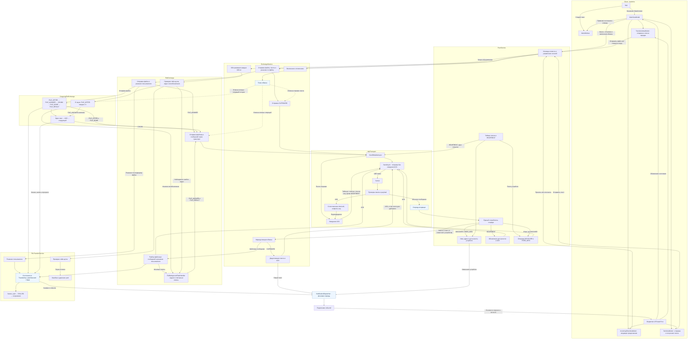

# Структура проекта

```text
LocalFileShare.slnx
LocalFileShare.csproj      
Program.cs              
src/
  Protocol/                 Классовая библиотека протокола и P2P-обмена
    ProtocolConstants.cs    Общие ограничения и интервалы обмена
    Extensions/             Общая отправка, учёт задач и классификация ошибок
    Messages/               Типы сообщений, пакет, payload и смещения полей
    Transport/              UDP, ACK, повторы, потери и статистика
    Peers/                  PeerService, обнаружение и доступность устройств
    Exchange/               Управление обменом, текст и доставка уведомлений
    Transfers/              Файловый сценарий и управление передачами
      Files/                Чтение, запись, проверка SHA-256 и безопасные имена
      Models/               Снимки, ключи, состояния и внутренняя запись передачи
  Client/                   Avalonia-приложение
    Views/                  Окна и разметка
    ViewModels/             Модели сессии, настроек, текста, отправки и входящих предложений
    Models/                 Модели клиента
    Settings/               Загрузка и сохранение настроек профиля
    Extensions/             Вывод размера файлов и понятных сообщений об ошибках
tests/
  Protocol.Tests/           Тесты Protocol на xUnit
```

## Работа сервисов


