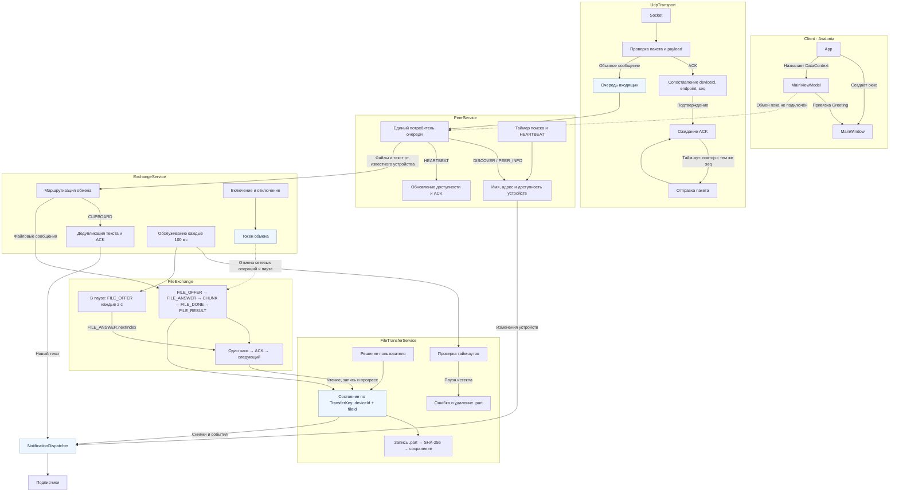

# Структура проекта

```text
LocalFileShare.slnx
src/
  Protocol/                 Классовая библиотека протокола и P2P-обмена
    ProtocolConstants.cs    Общие ограничения и интервалы обмена
    Extensions/             Общая отправка, учёт завершения задач и сетевые ошибки
    Messages/               Типы сообщений, пакет, payload и смещения полей
    Transport/              UDP, ACK, повторы, потери и статистика
    Peers/                  PeerService, обнаружение и доступность устройств
    Exchange/               Управление обменом, текст и доставка уведомлений
    Transfers/              Файловый сценарий и управление передачами
      Files/                Чтение, запись, проверка SHA-256 и безопасные имена
      Models/               Снимки, ключи, состояния и внутренняя запись передачи
  Client/                   Avalonia-приложение
    Views/                  Окна и разметка
    ViewModels/             Состояние и команды UI
    Models/                 Модели клиента
    Assets/                 Ресурсы клиента
tests/
  Protocol.Tests/           Тесты Protocol на xUnit
    Messages/               Сетевой формат и некорректные пакеты
    Transport/              Доставка, ACK, повторы и дедупликация
    Peers/                  Обнаружение и обмен нескольких PeerService
    Exchange/               Уведомления подписчикам
    Transfers/              Файлы, пауза, возобновление и отмена
      Files/                Безопасные имена файлов
```


## Работа сервисов


